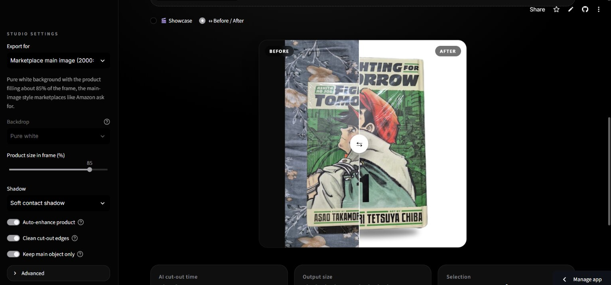

# 📸 Product Photo Studio

**Turn a casual phone photo into a studio-grade, marketplace-ready product shot in seconds.**

AI background removal, click-to-select refinement, studio backdrops and shadows, and export presets for marketplaces and social media, all running on CPU with open-source models.

**🔗 Live demo:** https://appuct-photo-studio-cc8mo5vjumocjpjkj2qlse.streamlit.app



---

## ✨ Features

- **AI background removal** with three model choices: U²-Net (balanced), IS-Net (sharp edges) and BiRefNet lite (best quality).
- **Click to select:** click the product to keep it, and click anything else (a hand, another object) to remove it. The selection follows the edges in the photo.
- **Main-object isolation:** stray objects and background haze are dropped automatically.
- **Export presets:** marketplace main image (pure white, product fills ~85% of a 2000×2000 frame), Shopify, Instagram post (4:5), Instagram story (9:16) and square.
- **Studio look:** 6 backdrops (white, studio grey, spotlight, warm beige, soft pastel, luxury dark) or a custom colour, plus contact shadow, drop shadow or a fading floor reflection.
- **Auto-enhance and edge clean-up** for a crisp product without halos.
- **Batch mode:** process up to 10 photos at once and download them as a ZIP.
- **Cinematic preview:** a 3D showcase where a virtual camera moves around the result, plus an interactive before/after slider.

## 🧠 How it works

| Step | What happens |
|------|--------------|
| 1. Orientation fix | EXIF data is read so phone photos are never sideways. |
| 2. AI matting | A segmentation model (via [rembg](https://github.com/danielgatis/rembg) on ONNX Runtime) produces a soft foreground mask. |
| 3. Main-object isolation | The mask is eroded to break thin bridges, blobs are scored by size and closeness to the centre, and pixels are reassigned to the nearest kept blob. |
| 4. Click to select (optional) | The user's clicks become seeds for **random-walker segmentation**, which spreads them across the image and stops at strong colour edges. |
| 5. Hybrid mask | The click selection decides *what* the product is; the AI mask decides *exactly where its edges are*. |
| 6. Compositing | The product is trimmed, scaled for the chosen preset and placed on the backdrop with a shadow or reflection. |

## 🛠️ Engineering decisions

- **Caching per step.** The AI mask, the click selection and the final cut-out are cached separately, so changing the backdrop or shadow re-renders instantly without re-running any model.
- **Lightweight click-to-select.** I first tried Meta's Segment Anything (SAM), but its ~350 MB model ran out of memory on the free hosting tier. I replaced it with random-walker segmentation from scikit-image: the same user experience with no extra model download and a fraction of the memory.
- **Isolated UI fragment.** The click picker runs as a Streamlit fragment, so adding points redraws only the picker, not the whole app.
- **No dark fringes.** Cut-outs are rebuilt from the original photo's colours plus the mask, rather than from pre-blended output.
- **Separation of concerns.** All image logic lives in `studio.py` with no Streamlit code, so it can be tested and reused on its own.
- **Accessibility.** Animations are switched off automatically for users who prefer reduced motion.

## 🚀 Run it locally

```bash
git clone https://github.com/jaidheervemula/product-photo-studio.git
cd product-photo-studio
python -m venv venv
# Windows: venv\Scripts\activate    macOS/Linux: source venv/bin/activate
pip install -r requirements.txt
streamlit run app.py
```

The first run downloads the AI model (about 170 MB for U²-Net).

## 📁 Project structure

```
product-photo-studio/
├── app.py               # Streamlit UI: settings, preview, picker, batch mode
├── studio.py            # Image processing: masks, selection, compositing (no UI code)
├── style.css            # Visual design and animations
├── requirements.txt
└── .streamlit/
    └── config.toml      # Theme
```

## ⚠️ Known limitations

- Objects that physically touch the product (like the hand holding it) are kept by the automatic mode. Use **click to select** to remove them.
- Best results come from one product on a plain-ish surface.
- The free hosting tier sleeps when idle, so the first visit can take up to a minute to wake up.

## 🗺️ Ideas for the future

- AI-generated scene backgrounds (for example, a product on a marble table)
- Automatic lighting and colour correction per marketplace
- An API endpoint for bulk processing

## 🙌 Built with

Python · Streamlit · rembg · ONNX Runtime · scikit-image · SciPy · Pillow · streamlit-image-coordinates

## 📄 License

MIT. See [LICENSE](LICENSE).

---

Built by **[Jaidheer Vemula](https://github.com/jaidheervemula)** · [LinkedIn](https://www.linkedin.com/in/jaidheer-vemula-86a678380)
